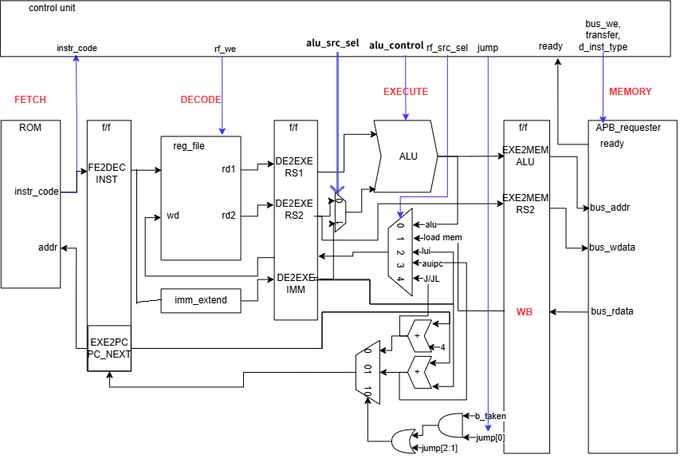
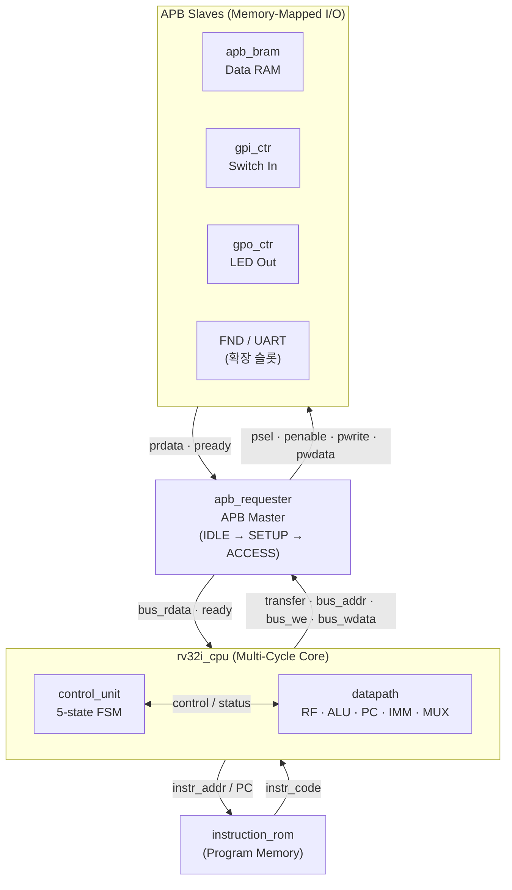
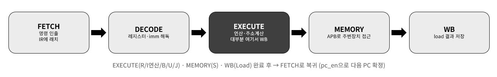
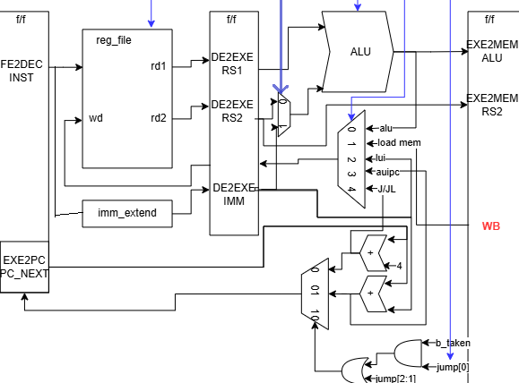

# RV32I Multi-Cycle CPU on FPGA

> RISC-V **RV32I** 명령어셋을 지원하는 **멀티사이클 CPU 코어**를 SystemVerilog로 설계하고,
> **APB 버스**로 RAM·GPIO 주변장치를 연결한 뒤 **Xilinx Basys-3(Artix-7) FPGA**에 구현한 팀 프로젝트.
> **UVM 검증환경(8만 벡터)** 과 **누적합 프로그램**으로 기능을 검증하고, 실제 보드에서 스위치 입력 → 연산 → LED 출력까지 동작을 확인했다.

<p>
  
  
  
  
  
</p>

---

## 📺 데모

<!--
[캡처 가이드] 아래 세 가지 중 있는 것부터 넣기. 파일은 docs/img/ 에 저장.
 1) FPGA 보드 데모: GitHub는 마크다운에 mp4 직접 업로드 지원 → 이슈/PR 코멘트 창에 영상을 드래그해
    올리면 생성되는 https://user-images.githubusercontent.com/... 링크를 아래 <video> 또는 그냥 붙여넣기.
    (또는 유튜브 업로드 후 썸네일 이미지 + 링크)
 2) 짧은 GIF: 보드 동작을 10초 내외 GIF로 만들어 docs/img/demo.gif 로 저장하면 아래 이미지가 바로 렌더됨.
-->


> 🎥 **전체 동작 영상:** _(여기에 업로드한 mp4 링크 또는 YouTube 링크)_

---

## 목차

- [프로젝트 개요](#프로젝트-개요)
- [주요 성과](#주요-성과-highlights)
- [시스템 아키텍처](#시스템-아키텍처)
- [마이크로아키텍처 (멀티사이클 FSM)](#마이크로아키텍처-멀티사이클-fsm)
- [지원 명령어 (RV32I)](#지원-명령어-rv32i)
- [APB 버스 & 주변장치](#apb-버스--주변장치)
- [검증 (Verification)](#검증-verification)
- [FPGA 구현 결과 (Basys-3)](#fpga-구현-결과-basys-3)
- [트러블슈팅](#트러블슈팅)
- [디렉토리 구조](#디렉토리-구조)
- [빌드 & 실행 방법](#빌드--실행-방법)
- [팀 & 역할 분담](#팀--역할-분담)
- [배운 점](#배운-점)

---

## 프로젝트 개요

| 항목 | 내용 |
|---|---|
| **주제** | RV32I 멀티사이클 CPU 코어 설계 및 APB 기반 미니 SoC(메모리 맵드 I/O) 구성, FPGA 구현 |
| **기간** | 2026.09.02 ~ 2026.09.15 |
| **팀 구성** | 4인 팀 프로젝트 |
| **타겟 보드** | Digilent Basys-3 (Xilinx Artix-7, `xc7a35t`) |
| **시스템 클럭** | 100 MHz (10 ns) |
| **설계 언어** | SystemVerilog |
| **시뮬레이션** | Synopsys VCS + Verdi (파형), UVM 1.2 |
| **합성/구현** | Xilinx Vivado |

**배경 및 목표**
- 단일 사이클 CPU 대비 **Critical Path가 짧은 멀티사이클 구조**를 직접 설계해 명령어 유형별 실행 사이클을 최적화한다.
- CPU 코어를 단독으로 끝내지 않고 **APB 버스 기반 메모리 맵드 I/O**로 RAM·GPIO를 통합한 **SoC 형태의 미니 시스템**을 구성한다.
- 시뮬레이션 검증에 그치지 않고 **실제 FPGA 온보드 + 타이밍 클로징**까지 완수한다.

---

## 주요 성과 (Highlights)

- ✅ **RV32I 정수 명령어 전체** (R / I / S / B / U / J 타입) 지원 — LUI·AUIPC·JAL·JALR 포함
- ✅ **5-state 멀티사이클 FSM**(FETCH→DECODE→EXECUTE→MEMORY→WB)으로 파이프 레지스터를 단계별로 분리
- ✅ **AMBA APB 인터페이스**로 메모리·주변장치를 주소맵(메모리 맵드 I/O) 기반으로 분리, 확장 가능한 미니 SoC 구조 확보
- ✅ **UVM 검증환경 구축** — ALU 연산 19종에 **총 8만 벡터** 분배, directed edge case + random 조합으로 골든 모델과 자동 비교
- ✅ **누적합(재귀/반복) 프로그램**을 기계어로 작성해 스택·함수 호출·분기 동작을 통합 검증
- ✅ **Basys-3 온보드 성공** — 스위치 입력을 받아 연산 후 LED로 출력, **Negative Slack(타이밍 위반) 해결**로 타이밍 클로징 완료

---

## 시스템 아키텍처


<!-- [캡처 가이드] PPT에서 만든 Top 블록도 이미지를 docs/img/block_diagram.png 로 저장.
     CPU 코어 - Instruction ROM - APB Requester - (RAM/GPI/GPO) 연결이 보이면 좋음. -->

`rv32i_top` 이 최상위 모듈이며 다음으로 구성된다.

- **`instruction_rom`** — 프로그램(기계어 `.mem`) 저장. PC(`instr_addr`)로 명령어를 읽어 CPU에 공급.
- **`rv32i_cpu`** — 컨트롤 유닛 + 데이터패스로 구성된 멀티사이클 코어.
- **`apb_requester`** — CPU의 메모리/IO 접근 요청을 **APB 마스터**로 변환하는 브리지.
- **주변장치(APB Slave)** — `apb_bram`(데이터 RAM), `gpi_ctr`(스위치 입력), `gpo_ctr`(LED 출력) 등.



---

## 마이크로아키텍처 (멀티사이클 FSM)


<!-- [캡처 가이드] PPT의 FSM 상태도(FETCH→DECODE→EXECUTE→MEMORY→WB)를 docs/img/fsm_state.png 로. -->

<!-- [캡처 가이드] PPT의 데이터패스 다이어그램을 docs/img/datapath.png 로. -->

컨트롤 유닛(`control_unit.sv`)은 다음 **5개 상태**를 순회하며, 각 단계 사이에 **파이프 레지스터**(`FE2DEC`, `DE2EXE`, `EXE2MEM`, `MEM2WB`)를 두어 데이터를 넘긴다.

| 상태 | 하는 일 | 다음 상태 |
|---|---|---|
| **FETCH** | ROM에서 명령어를 읽어 `FE2DEC` 레지스터에 래치 | DECODE |
| **DECODE** | 레지스터 파일 읽기 + immediate 확장, `DE2EXE`에 래치 | EXECUTE |
| **EXECUTE** | ALU 연산 / 분기 판단 / PC 갱신. 대부분 명령은 여기서 완료 | FETCH (또는 MEMORY) |
| **MEMORY** | Load/Store만 진입. APB 트랜잭션 요청 후 `ready` 대기 | WB(Load) / FETCH(Store) |
| **WB** | Load 데이터를 레지스터 파일에 write-back | FETCH |

- **명령어 유형별 사이클 최적화**: R/I/B/U/J 타입은 EXECUTE에서 바로 종료(3사이클), Store는 MEMORY까지(4사이클), Load만 WB까지(5사이클) 사용한다. 모든 명령을 최장 경로로 처리하는 단일 사이클 대비 **Critical Path를 짧게** 유지한다.
- **데이터패스 주요 블록**: `reg_file`(x0 하드와이어드 0), `alu`(산술/논리/시프트 + 분기 비교기 `b_taken`), `imm_extender`(타입별 부호확장), `program_counter`(PC+4 / PC+imm / rs1+imm one-hot 선택), 5:1 write-back MUX.

---

## 지원 명령어 (RV32I)

| 타입 | Opcode | 명령어 |
|---|---|---|
| **R-type** | `0110011` | ADD, SUB, SLL, SLT, SLTU, XOR, SRL, SRA, OR, AND |
| **I-type (산술)** | `0010011` | ADDI, SLTI, SLTIU, XORI, ORI, ANDI, SLLI, SRLI, SRAI |
| **I-type (Load)** | `0000011` | LW, LH, LB, LHU, LBU |
| **S-type (Store)** | `0100011` | SW, SH, SB |
| **B-type (분기)** | `1100011` | BEQ, BNE, BLT, BGE, BLTU, BGEU |
| **U-type** | `0110111` / `0010111` | LUI, AUIPC |
| **J-type (점프)** | `1101111` / `1100111` | JAL, JALR |

> ALU 제어는 `{funct7[5], funct3}` 4비트로 인코딩(`define.svh`), opcode/명령 enum은 디버깅 편의를 위해 `rv32i_pkg`에 타입으로 정의.

---

## APB 버스 & 주변장치

CPU의 메모리/IO 접근은 `apb_requester`가 **IDLE → SETUP → ACCESS** 3-state FSM으로 APB 프로토콜(`psel`/`penable`/`pready`)을 생성한다. 주소 상위 비트로 슬레이브를 선택한다.

| 주소 범위 (`addr[31:28]`) | 슬레이브 | 설명 |
|---|---|---|
| `0x1____` | RAM (`apb_bram`) | 데이터 메모리. SB/SH/SW·LB/LH/LW/LBU/LHU 바이트 단위 접근 지원 |
| `0x2_0__` | GPI (`gpi_ctr`) | 슬라이드 스위치 입력 |
| `0x2_1__` | GPO (`gpo_ctr`) | LED 출력 |
| `0x2_2__`~ | GPIO / FND / UART | 확장용 슬롯 (주소 디코더에 예약) |

- **핸드셰이크**: CPU는 MEMORY 상태에서 `transfer`를 올리고 APB `ready`가 뜬 사이클에만 로드 데이터를 `MEM2WB` 레지스터에 래치해 데이터 정합성을 보장한다.
- **바이트 주소 처리**: `apb_bram`이 `d_inst_type`(funct3)에 따라 바이트/하프워드/워드 write·부호/제로 확장 read를 처리한다.

---

## 검증 (Verification)


<!-- [캡처 가이드] Verdi 파형 캡처(레지스터 write-back, PC 진행, APB handshake가 보이는 구간)를 docs/img/sim_waveform.png 로. -->

**1) UVM 검증환경** (`tb/tb_rv32i_uvm.sv`)
- Sequence / Driver / Monitor / Scoreboard / Coverage 기반 UVM 1.2 환경.
- **ALU 연산 19종(R타입 10 + I타입 9)** 을 대상으로 **총 80,000 벡터**를 분배 검증(연산당 약 4,200개). 연산별 앞 6개는 **directed edge case**(0·1·-1·부호 min/max·시프트 경계), 나머지는 **랜덤 오퍼랜드**.
- Scoreboard의 **골든 모델(`reference_result`)** 로 기대값을 계산해 DUT write-back과 `===` 자동 비교, 연산별 pass/fail·edge 도달(114 = 19×6) 집계.
- **VCS 코드 커버리지**(`-cm line+cond+fsm+tgl+branch+assert`, Makefile `SIMV_OPTS`)로 RTL 실행 범위 측정.
- Load/Store·Branch·Jump 등 흐름 제어 명령은 UVM 범위 밖이며, 아래 **누적합 프로그램**으로 통합 검증.

**2) 프로그램 레벨 자가검증 — 누적합(cumulative sum)**
- 누적합을 계산하는 프로그램을 **RV32I 기계어로 직접 작성**(`rtl/rom_code_*.mem`)해 ROM에 로드.
- 스택 프레임(`addi sp, sp, -imm`), 함수 호출(`jal`/`jalr`), 반복·분기(`bne` 등), 메모리 store/load가 **하나의 실제 프로그램 안에서** 맞물려 동작하는지 통합 검증.
- 단위 명령 검증(UVM)과 프로그램 흐름 검증(누적합)을 병행해 신뢰도를 높였다.

**3) 기본 테스트벤치** (`tb/tb_rv32i.sv`) — 초기 브링업 및 파형 확인용.

<!-- [선택] UVM 리포트/커버리지 요약 스크린샷이 있으면: -->
<!--  -->

---

## FPGA 구현 결과 (Basys-3)

핀 매핑은 `Basys-3-Master.xdc`에 정의 (clk=W5 100 MHz, 슬라이드 스위치 → `sw[11:0]`, LED → `led[11:0]`).

**리소스 사용량** <!-- Vivado Utilization 리포트 값으로 채우기 -->

| Resource | Used | Available | Util % |
|---|---|---|---|
| LUT (Logic) | 869 | 20800 | 4.18% |
| LUTRAM (Distributed RAM) | 112 | 9600 | 1.17% |
| FF | 316 | 41600 | 0.76% |

> 💡 명령어 ROM·데이터 RAM이 **Block RAM이 아니라 LUTRAM(분산 RAM)** 으로 합성됨.
> `apb_bram`/`instruction_rom`의 read가 비동기(`always_comb`/`assign`)라 BRAM(동기 읽기) 추론 조건을 만족하지 않고,
> 128워드 규모라 분산 RAM이 더 효율적이기 때문. (BRAM으로 올리려면 출력에 레지스터를 둔 동기 read 구조로 변경 필요)


<!-- [캡처 가이드] Vivado > Implementation > Report Utilization 캡처를 docs/img/utilization.png 로. -->

**타이밍** <!-- Vivado Timing Summary 값으로 채우기 -->

| 지표 | 값 |
|---|---|
| Target Clock | 100 MHz (10 ns) |
| WNS (Worst Negative Slack) | _TODO (ns)_ |
| 타이밍 위반 (초기) → 해결 후 | _아래 트러블슈팅 참고_ |


<!-- [캡처 가이드] Vivado Timing Summary(WNS 양수 확인 구간) 캡처를 docs/img/timing_summary.png 로. -->

---

## 트러블슈팅

### 🔧 Negative Slack (타이밍 위반) 해결
- **현상**: 초기 구현에서 `create_clock -period 10.00`(100 MHz) 제약 하에 **WNS가 음수**로 나와 타이밍 클로징에 실패.
- **원인 분석**: <!-- 실제 원인으로 수정 --> Critical Path가 특정 조합 경로(예: ALU → write-back MUX → 레지스터 파일, 또는 ROM read → decode 경로)에 집중되어 setup 마진을 잠식.
- **해결**: <!-- 실제로 적용한 방법으로 수정. 예시 --> 파이프 레지스터 단계 재배치 / 조합 로직 분할 / 불필요한 경로 제거 / (필요 시) 클럭 제약 조정으로 **WNS를 양수로 전환**해 타이밍 클로징 완료.
- **결과**: 100 MHz에서 안정 동작, 보드에서 오동작 없이 스위치→연산→LED 출력 확인.

### 🔧 그 외
- **APB ready 핸드셰이크**: Load 시 `ready`가 뜨기 전에 데이터를 래치하면 잘못된 값이 write-back → `ready` 사이클에만 `MEM2WB`를 enable하도록 FSM 조건 수정.
- **바이트 주소 정렬**: SB/SH/SW의 바이트 오프셋 처리 및 Load 부호/제로 확장 로직 정리.

---

## 디렉토리 구조

```
proj_rv32i_multi_cycle_cpu/
├── rtl/
│   ├── rv32i_cpu.sv          # top(rv32i_top) + CPU(rv32i_cpu)
│   ├── control_unit.sv       # 멀티사이클 5-state FSM 컨트롤러
│   ├── datapath.sv           # RF/ALU/PC/IMM/MUX/파이프 레지스터
│   ├── apb_requester.sv      # APB 마스터(브리지) + 주소 디코더 + MUX
│   ├── apb_bram.sv           # 데이터 RAM (APB slave)
│   ├── gpi_ctr.sv / gpo_ctr.sv / gpio_control.sv  # GPIO 컨트롤러
│   ├── instruction_rom.sv    # 명령어 ROM (.mem 로드)
│   ├── data_memory.sv
│   ├── define.svh            # ALU 제어 매크로
│   ├── pkg/rv32i_pkg.sv      # opcode / 명령어 enum (디버그용 타입)
│   └── rom_code_*.mem        # 테스트 프로그램(기계어): gpio / gpio_sw / ram_apb / ex1
├── tb/
│   ├── tb_rv32i.sv           # 기본 테스트벤치
│   └── tb_rv32i_uvm.sv       # UVM 검증환경 (8만 벡터)
├── Basys-3-Master.xdc        # FPGA 핀/클럭 제약
├── Makefile                  # VCS 컴파일 / 시뮬 / Verdi 실행
└── docs/img/                 # 블록도·파형·리소스·데모 이미지 (직접 추가)
```

---

## 빌드 & 실행 방법

### 시뮬레이션 (VCS + Verdi)

```bash
# 1) 파일 리스트 생성 + VCS 컴파일 + 시뮬 실행
make            # = make run + make simv

# 개별 타겟
make generate_f # rtl/tb 소스를 모아 files.f 자동 생성
make run        # files.f 로 VCS 컴파일 → build/simv 생성
make simv       # 시뮬레이션 실행 (커버리지 + UVM_HIGH 로그)
make verdi      # Verdi 로 wave.fsdb 파형 열기
make clean      # 빌드/로그/파형 산출물 정리
```

**요구 환경**: Synopsys VCS (UVM 1.2 지원), Verdi. `-full64 -sverilog -kdb -lca`, `-timescale=1ns/1ps`.

### FPGA 구현 (Vivado)

1. `rtl/` 소스와 `Basys-3-Master.xdc`를 프로젝트에 추가하고 top module을 `rv32i_top`으로 설정.
2. 실행할 프로그램(`rom_code_*.mem`)을 `instruction_rom.sv`의 `$readmemh` 대상으로 지정.
3. Synthesis → Implementation → Generate Bitstream → Basys-3에 프로그래밍.
4. 슬라이드 스위치로 입력 → LED로 결과 확인.

---

## 팀 & 역할 분담

> 팀 프로젝트로 진행했으며, 멤버별로 fork 하여 개별 포트폴리오로도 활용 중.

| 멤버 | 담당 | 주요 기여 |
|---|---|---|
| **박정민** (본인) | CPU 코어 설계 · 검증 · FPGA | 멀티사이클 CPU 코어 설계, **누적합 프로그램 기계어 작성으로 통합 검증**, **FPGA 온보드 및 Negative Slack 해결**(타이밍 클로징) |
| 팀원 B | _TODO_ | _TODO (예: APB/주변장치, UVM 환경 등)_ |
| 팀원 C | _TODO_ | _TODO_ |

<!-- 팀원 실명/역할은 협의 후 채우기. 저장소 기여자: jeongmin-0113(본인), gurwn031107, hongs0396 -->

---

## 배운 점

- 단일 사이클 대비 멀티사이클의 **Critical Path 최적화 트레이드오프**(면적/제어 복잡도 ↔ 최대 주파수)를 실측으로 이해.
- CPU를 **표준 버스(APB)** 위에 올려 주변장치를 확장 가능한 구조로 통합하는 SoC 관점 습득.
- 시뮬레이션 통과가 곧 하드웨어 동작은 아님 — **타이밍 클로징(WNS)** 이라는 실물 구현의 벽을 직접 넘어봄.
- 단위 명령 검증(UVM)과 프로그램 흐름 검증(누적합)을 **계층적으로** 병행하는 검증 전략의 효용.

---

<sub>RISC-V RV32I Multi-Cycle CPU · SystemVerilog · VCS/Verdi · UVM · Vivado · Basys-3 (Artix-7)</sub>
